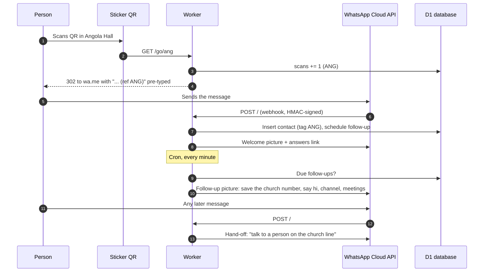

# FCC Ife Bot

WhatsApp bot for **Fullness of Christ Church, Ile-Ife**. It answers people who scan the
church's question stickers on campus ("Ever wondered why you exist?"), follows up
automatically, and hands them over to a real person on the church line, while tracking
which location each person came from.

Serverless, event-driven and free to run: one Cloudflare Worker, one D1 (SQLite) database,
a one-minute cron, and GitHub Actions for CI/CD.

## How it works



## Features

| Feature | Detail |
|---|---|
| Location tracking | Each sticker location has its own QR (`/go/ang`, `/go/moz`). The tag rides in the pre-filled message, so every chat is attributed with no manual work. |
| Picture messages | Welcome and follow-up are sent as images with captions; falls back to text if an image fails. |
| Scheduled follow-up | Stored in D1 with a due time; a one-minute cron sends what's due (with retries and error logging). |
| Hand-off | Returning people get one reply pointing to the human-run church line (rate-limited, never before the follow-up). |
| Idempotent webhook | First-contact insert uses `ON CONFLICT DO NOTHING`, so Meta's retries never double-send. |
| Security | Webhook requests verified with Meta's `X-Hub-Signature-256` (HMAC-SHA256, constant-time compare). Secrets never in the repo. |
| Admin stats | Admin numbers text `STATS` to get scans, chats and follow-ups per location, this week and all time. |
| Link previews | Sticker links shared in chats show an Open Graph card; crawler hits aren't counted as scans. |
| Privacy page | `/privacy`, required by Meta to publish the app. |

## Routes

| Route | Purpose |
|---|---|
| `GET /go/<tag>` | QR landing: count scan, redirect to WhatsApp with tagged message |
| `GET /privacy` | Privacy policy |
| `GET /` | Meta webhook verification |
| `POST /` | Meta webhook: incoming messages |
| `GET /img/*` | Static images (`public/`) |
| cron `* * * * *` | Send due follow-ups |

## Stack

- **Runtime:** Cloudflare Workers (JavaScript, no dependencies)
- **Data:** Cloudflare D1 (SQLite): `contacts`, `stats`, `followups` (see `schema.sql`)
- **Messaging:** WhatsApp Business Platform, Cloud API (Graph API)
- **CI/CD:** GitHub Actions: check on every PR; on merge to `main` it finds or creates the
  database, applies the schema, deploys, syncs secrets and smoke-tests the live endpoints
- **Cost:** $0. Workers free plan (100k requests/day), D1 free tier, WhatsApp's 1,000 free
  service messages per number per month

## Repository layout

```
src/index.js                       the bot
schema.sql                         D1 tables (idempotent)
public/img/                        message and preview images
wrangler.toml                      Worker config: numbers, location tags, message texts
.github/workflows/deploy.yml       CI/CD
.github/workflows/connect-waba.yml one-off: link a WhatsApp Business Account to the Meta app
```

## Configuration

Non-secret settings live in `wrangler.toml` (`[vars]`): phone numbers, location tags,
links and message texts. Adding a location is one line in `TAGS`.

Secrets live in **GitHub → Settings → Secrets and variables → Actions** and are copied into
Cloudflare on each deploy:

| Secret | What |
|---|---|
| `CLOUDFLARE_API_TOKEN` | Cloudflare token ("Edit Cloudflare Workers" + D1 Edit) |
| `CLOUDFLARE_ACCOUNT_ID` | Cloudflare account ID |
| `META_VERIFY_TOKEN` | Webhook verify string (also entered in Meta) |
| `META_APP_SECRET` | Meta app secret (signature verification) |
| `META_ACCESS_TOKEN` | WhatsApp access token (system-user token in production) |
| `ADMIN_NUMBERS` | Comma-separated numbers allowed to use `STATS` (optional) |

To rotate a token: update the GitHub secret, then **Actions → Deploy → Run workflow**.

## Local development

```bash
npm install
cp .dev.vars.example .dev.vars
npx wrangler d1 execute fcc-ife-bot --local --command="$(sed -e 's/--.*$//' schema.sql | tr '\n' ' ')"
npx wrangler dev --test-scheduled      # http://localhost:8787 ; trigger the cron at /__scheduled
```

## Meta setup (once per phone number)

1. Meta app with the **Connect with customers through WhatsApp** use case; app published.
2. Webhook: callback `https://fcc-ife-bot.fullnessife.workers.dev/`, subscribe to `messages`.
3. Privacy policy URL: `https://fcc-ife-bot.fullnessife.workers.dev/privacy`.
4. Register the number, then **Actions → Connect WhatsApp account** with its WABA ID.
